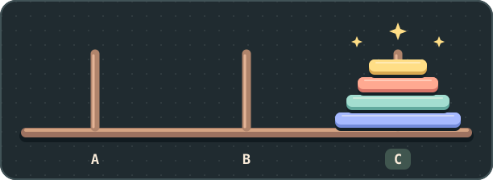

### Hey, I'm Ron :)

I'm a full-stack developer. I like taking a rough idea and turning it into something people can use.

When I'm not working, I make stuff I wish existed. ✨

Sometimes it's a tool, and sometimes it's a toy. I make some of it for myself and some of it for people I care about.

Feel free to [say hi on LinkedIn](https://www.linkedin.com/in/ron-hasson/).

🧩

<!-- hanoi:start -->

#### tower of hanoi

**we did it!** ✨

[play again](https://github.com/ronhasson/ronhasson/issues/new?title=%5BHanoi%5D+22+reset&body=Submit+this+issue+to+play.+The+game+will+close+it+after+processing+your+turn.)

pick a link, submit the prefilled issue, then refresh to see the shared board.

<!-- hanoi:end -->

<!--
**ronhasson/ronhasson** is a ✨ _special_ ✨ repository because its `README.md` (this file) appears on your GitHub profile.

Here are some ideas to get you started:

- 🔭 I’m currently working on ...
- 🌱 I’m currently learning ...
- 👯 I’m looking to collaborate on ...
- 🤔 I’m looking for help with ...
- 💬 Ask me about ...
- 📫 How to reach me: ...
- 😄 Pronouns: ...
- ⚡ Fun fact: ...
-->
